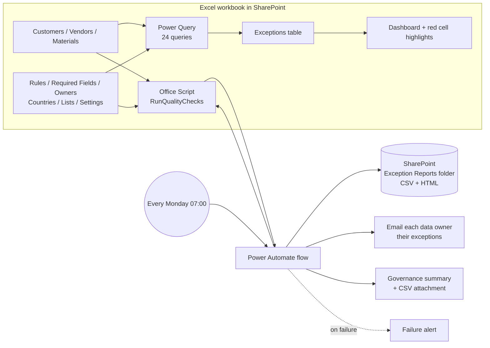

# Automated Master Data Quality Check

Excel Power Query, Office Scripts, Power Automate and SharePoint.

- A **Power Query** workflow flags **duplicate, missing and inconsistent** customer, vendor and material master records (25 configurable rules, exact and fuzzy duplicate matching, per-country format validation, referential integrity, IBAN checksum).
- A **Power Automate** flow runs every Monday, **saves the weekly exception report to SharePoint** (CSV + styled HTML) and **emails every data owner** only their own exceptions, plus a summary to data governance.
- An Excel **dashboard** and a browser-based **Data Quality Console** show severity, entity health, rule hits and owner workload.

## What's in the box

| File | What it is |
|---|---|
| `MasterDataQuality.xlsx` | The workbook. Dashboard, Exceptions (Power Query output), Customers / Vendors / Materials (source data, offending cells highlighted red, `DQ_Issues` per record), Automated Run log, and the Rules, Required Fields, Owners, Countries, Lists and Settings configuration sheets. 24 Power Query queries are embedded. |
| `powerquery/*.pq` + `powerquery/Section1.m` | Every query as source, for review or for pasting into another workbook (Data > Get Data > Blank Query > Advanced Editor). |
| `automation/RunQualityChecks.ts` | Office Script the flow runs (same rules as Power Query). |
| `automation/MasterDataQuality_WeeklyFlow.zip` | Power Automate import package. |
| `automation/flow/definition.json` | The flow definition, readable. |
| `MasterDataQualityConsole.html` | Stand-alone web console. Open it in a browser and upload any workbook built from the template to check it. |
| `docs/SETUP.md` | Step-by-step SharePoint, Office Script and flow setup. |
| `source/` | Generator, rules engine, build scripts and the full test-suite (`./build.sh` rebuilds and re-tests everything). |

## How it fits together



Power Automate cannot refresh Power Query in Excel for the web, so the weekly run uses an Office Script built from the **same rules engine**. The test-suite proves the Power Query output and the Office Script output are identical, row for row and column for column.

## Rule catalogue

Every rule can be switched off, re-graded or tuned on the **Rules** sheet; no code changes needed.

| Rule | Category | Name | Applies to | Default severity | Logic |
|---|---|---|---|---|---|
| DUP-001 | Duplicate | Duplicate record ID | Customer, Vendor, Material | Critical | The same primary key appears on more than one row. Every occurrence after the first is flagged. |
| DUP-002 | Duplicate | Exact duplicate record | Customer, Vendor, Material | High | Same normalised name and country (partners) or same normalised description, type and UoM (materials). |
| DUP-003 | Duplicate | Duplicate tax ID | Customer, Vendor | High | Two records share the same tax / VAT registration number. |
| DUP-004 | Duplicate | Duplicate email address | Customer, Vendor | Medium | Two records share the same email address. |
| DUP-005 | Duplicate | Potential (fuzzy) duplicate | Customer, Vendor, Material | Medium | Name/description similarity (Dice coefficient on character bigrams) at or above the threshold within the same country or material type. |
| DUP-006 | Duplicate | Duplicate bank account (IBAN) | Vendor | Critical | Two vendors are paid into the same bank account - a common payment-fraud indicator. |
| MIS-001 | Missing | Required field missing | Customer, Vendor, Material | High | A field listed in the Required Fields table is blank. |
| MIS-002 | Missing | Purchased material has no vendor | Material | High | Materials whose type is in the PurchasedMaterialType list (ROH, HAWA by default) must have a preferred vendor. |
| INC-001 | Inconsistent | Invalid email format | Customer, Vendor | Medium | Email must have one @, a non-empty local part, a dotted domain, a 2+ letter TLD and no spaces. |
| INC-002 | Inconsistent | Invalid phone number | Customer, Vendor | Low | Phone must be +<country calling code> followed by digits, 8-15 digits in total. |
| INC-003 | Inconsistent | Invalid country code | Customer, Vendor | High | Country must be an upper-case ISO 3166 alpha-2 code from the Countries table. |
| INC-004 | Inconsistent | Tax ID format invalid for country | Customer, Vendor | High | Tax ID does not match the country's tax ID pattern. |
| INC-005 | Inconsistent | Postal code format invalid | Customer, Vendor | Medium | Postal code does not match the country's postal code pattern. |
| INC-006 | Inconsistent | Invalid currency code | Customer, Vendor, Material | Medium | Currency is not in the approved currency list. |
| INC-007 | Inconsistent | Invalid payment terms | Customer, Vendor | Medium | Payment terms are not in the approved payment terms list. |
| INC-008 | Inconsistent | Name formatting issue | Customer, Vendor, Material | Low | Leading/trailing spaces, repeated spaces or an all lower-case name. |
| INC-009 | Inconsistent | Invalid or future created date | Customer, Vendor, Material | Medium | Created date is not a valid date or is later than the run date. |
| INC-010 | Inconsistent | Invalid status value | Customer, Vendor, Material | Low | Status is not one of the approved status values. |
| INC-011 | Inconsistent | Invalid unit of measure | Material | High | Base unit of measure is not in the approved UoM list. |
| INC-012 | Inconsistent | Invalid material type | Material | Medium | Material type is not in the approved material type list. |
| INC-013 | Inconsistent | Vendor not found in vendor master | Material | High | Preferred vendor ID does not exist in the vendor master (broken reference). |
| INC-014 | Inconsistent | Preferred vendor is blocked | Material | Medium | Preferred vendor exists but its status is Blocked. |
| INC-015 | Inconsistent | Invalid numeric value | Customer, Material | High | Credit limit must be a number >= 0; standard price a number > 0; gross weight a number >= 0. |
| INC-016 | Inconsistent | Invalid IBAN | Vendor | High | IBAN fails the length check for its country or the ISO 13616 mod-97 checksum. |
| INC-017 | Inconsistent | Invalid plant | Material | Low | Plant is not in the approved plant list. |

Required fields and their severities are listed on the **Required Fields** sheet. Country formats use masks (`#` digit, `@` letter, `?` either, `|` alternatives) on the **Countries** sheet.

**Routing:** each exception goes to the owner on the **Owners** sheet matching *Entity + Region* (region comes from the record's country), then *Entity + \**, then *\* + \**. Records with an invalid country route to data governance.

**Duplicates:** for every duplicate group the first record is treated as the survivor and every later record is flagged, with `RelatedRecordID` pointing at the survivor. Fuzzy matching compares normalised names (lower-case, punctuation removed, legal forms such as Inc, Ltd, GmbH dropped) using the Dice coefficient on character bigrams, within the same country (partners) or material type (materials).

## Exception report columns

`ExceptionID, RunDate, Entity, SourceRow, RecordID, RecordName, Region, RuleID, Category, RuleName, Field, Value, Details, Severity, SeverityRank, RelatedRecordID, OwnerName, OwnerEmail, Status`

## How it was verified

| Check | Result |
|---|---|
| Sample data | 498 records with 168 deliberately planted defects (ground truth recorded by the generator) |
| Rules engine unit + end-to-end tests | 18/18 pass. All 168 defects found, 0 false positives on clean records |
| Power Query M | All 24 queries parse with Microsoft's official Power Query parser, then are **executed** by a test M interpreter against the workbook tables: output identical to the engine in all 19 columns, plus rule on/off, severity change and run-date override all behave correctly through M |
| Workbook | 740 formulas recalculated with 0 errors; dashboard figures equal the engine's; Microsoft's connected-workbooks library re-parses the embedded Power Query package and its query text is byte-identical to the tested one |
| Office Script | Type-checks under strict TypeScript; run against a mock Excel workbook (dates as serials, blanks as "") its CSV is identical to the Power Query output |
| Power Automate flow | Every expression parsed and evaluated in a flow simulator: 2 files saved to SharePoint, 10 owner emails with working report links and correct importance, governance summary with CSV attachment, and the failure alert path |
| Web console | Driven in Chromium: KPIs, filters, record drawer, email preview, live rule toggles, uploading the generated workbook, phone width with no horizontal scroll |

**Needs your Microsoft 365 tenant (cannot be run outside it):** opening the workbook in Excel and refreshing Power Query, running the Office Script in Excel for the web, importing and running the flow, SharePoint file creation and Outlook delivery. `docs/SETUP.md` walks through each, and section 6 there rebuilds the flow by hand if your tenant blocks the legacy package import.

## Rebuild and re-test

```bash
npm install        # typescript, esbuild, @microsoft/powerquery-parser, @microsoft/connected-workbooks, jszip, playwright
./build.sh         # regenerates data, engine, M, workbook, Office Script, flow and console, and runs every test
```

All people, companies and email addresses in the sample data are fictional (contoso.com).
